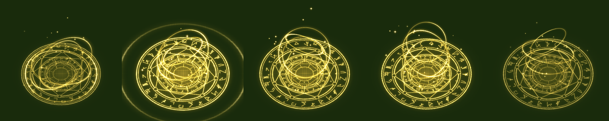

# Resist Buff Efekti — Unity Paketi

> Tarih: 13 Kasım 2026

Direnç (resist) becerisi kullanıldığında karakterin üstünde oynayan efekt:
yerde dönen rün çemberi, gövdenin etrafında yalpalayan üç halka, açılış şok
halkası ve yükselen kıvılcımlar.



*Yukarıdaki görsel Unity ekran görüntüsü değil; script'teki matematiğin Python
ile kaba bir yazılım çizimi (0.08 / 0.25 / 0.6 / 1.1 / 1.6. saniyeler).*

## 0. Bu ne, ne değil

Referans ekran görüntülerindeki efektin **tarzında özgün bir efekt**tir;
MykoMobile'ın dokuları veya efekt dosyaları çıkarılıp kullanılmadı (gerekçe:
`docs/06` Bölüm 0 ile aynı). Bütün dokular `tools/generate_resist_vfx.py` ile
prosedürel üretildi, rün işaretleri rastgele çizgilerden oluşur.

## 1. Kurulum

**Yol A — paket:** Unity'de `Assets > Import Package > Custom Package...` →
`unity/ResistBuffEffect.unitypackage`.

**Yol B — klasör:** `unity/Assets` içeriğini projenin `Assets` klasörüne kopyala.

İkisi de aynı 7 dosyayı getirir:

| Dosya | İşlev |
|---|---|
| `Scripts/VFX/ResistBuffEffect.cs` | Efektin tamamı (kurulum + animasyon) |
| `Scripts/Editor/ResistBuffEffectMenu.cs` | Deneme ve prefab üretme menüleri |
| `Resources/VFX/ResistBuff/KorayAdditive.shader` | Additive, ışıksız shader (Built-in + URP) |
| `Resources/VFX/ResistBuff/*.png` | 4 gri doku: rün çemberi, halka, parıltı, kıvılcım |

Prefab, materyal veya Particle System ayarı **yok** — hepsi kodla kurulur.

## 2. Kullanım

```csharp
using Koray.VFX;

// Skill kullanıldığında — hedefi takip eder, 1.8 sn sonra kendini yok eder
ResistBuffEffect.Play(karakter.transform, ResistElement.Fire);

// Buff süresince kalıcı aura
var fx = ResistBuffEffect.Play(karakter.transform, ResistElement.Ice, loop: true);
fx.Stop();   // buff bitince: yumuşakça söner
```

Elementler: `Fire` (altın), `Ice` (mavi), `Lightning` (mor), `Poison` (yeşil),
`Custom` (`customColor` alanı).

**Hızlı deneme:** Play'e bas → sahnede bir obje seç →
`Tools > Koray > VFX > Resist Efektini Dene`.

**Prefab olarak:** `Tools > Koray > VFX > Resist Efekti Prefab'larını Üret`
`Assets/GameData/VFX` altına 4 prefab yazar; `SkillDefinition.CastVfx` alanına
sürükleyip `Instantiate(prefab, karakter.transform)` etmen yeterli.

## 3. Ayarlar (Inspector veya kod)

| Alan | Varsayılan | Açıklama |
|---|---|---|
| `radius` | 1.15 | Yer çemberinin yarıçapı (m) |
| `height` | 1.7 | Karakter boyu; halka ve kıvılcım yüksekliği |
| `intensity` | 1 | Genel parlaklık |
| `sparkCount` | 26 | Kıvılcım sayısı (0 = kapalı) |
| `duration` | 1.8 | Tek seferlik oynatma süresi (sn) |
| `groundOffset` | 0.04 | Zeminle titreşmeyi önleyen yükseklik |

Maliyet: 8 draw call, ~120 üçgen, karede sıfır bellek tahsisi.

## 4. Doğrulama durumu

- C# derlemesi: `bash tools/unity-compile-check/check.sh` → geçti.
- **Unity içinde çalıştırılmadı** (bu ortamda Unity yok). Shader derlemesi,
  görünüm ve `.unitypackage` içe aktarımı ilk açılışta senin tarafında
  doğrulanacak. Bilinen sınırlar:
  - Çember düzdür, eğimli araziye yatmaz; gömülürse `groundOffset`'i artır.
  - HDRP desteklenmez (Built-in ve URP hedeflendi).

## 5. Yeniden üretim

```bash
python3 tools/generate_resist_vfx.py          # dokular
python3 tools/build_resist_unitypackage.py    # .unitypackage + .meta
```
