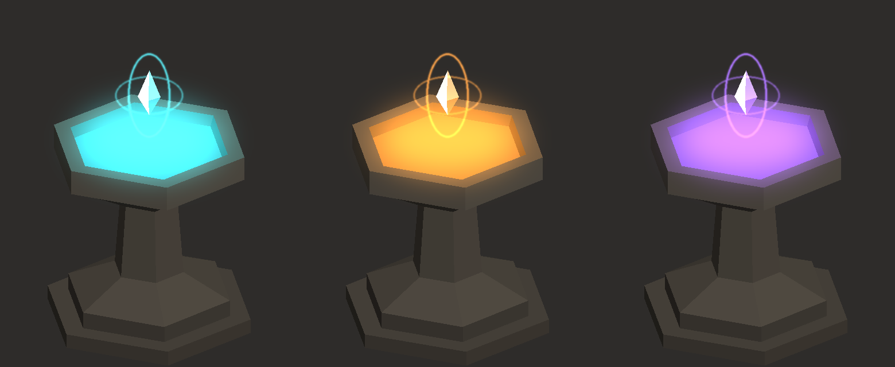

# Yükseltme Sunağı — Unity Paketi

> Tarih: 13 Kasım 2026

Eşya yükseltme (upgrade) noktası olarak kullanılacak dekor: altıgen taş kaide,
içinde dönen enerji havuzu, üstünde süzülen kristal çekirdek ve iki halka.



*Unity ekran görüntüsü değil; script'teki geometri ve renk matematiğinin Python
ile kaba çizimi. Üç örnek `energyColor` değeri: turkuaz (varsayılan), kehribar, mor.
Havuzdaki girdap deseni ve taş dokusu bu çizimde yok.*

## 0. Neden "birebir Anvil" değil

İstek, MykoMobile ekran görüntülerindeki Anvil'in boyut, renk ve grafik olarak
birebir aynısıydı. O model başka bir oyunun sanat varlığı; kopyasını üretmek
`docs/01` Bölüm 4 ve `docs/06` Bölüm 0'daki gerekçelerle projenin kaçındığı şey.
Bunun yerine **aynı işlevi gören özgün bir tasarım** yapıldı: farklı silüet
(altıgen, basamaklı taban), küre yerine kristal çekirdek, farklı varsayılan renk.
Renk, boyut ve parlaklık Inspector'dan serbestçe ayarlanır.

## 1. Kurulum

Unity'de `Assets > Import Package > Custom Package...` →
`unity/UpgradeAltar.unitypackage` (9 dosya). Resist efekti paketiyle üç dosyayı
paylaşır; ikisi birlikte içe aktarılabilir.

Sahneye eklemek için: `GameObject > Koray > Yükseltme Sunağı`
(veya boş bir objeye `UpgradeAltar` bileşenini ekle). Editörde de görünür.

## 2. Ayarlar

| Alan | Varsayılan | Açıklama |
|---|---|---|
| `height` | 1.25 | Yerden havuz kenarına yükseklik (m); genişlik orantılı (~1.25 m) |
| `energyColor` | turkuaz | Havuz, çekirdek, halkalar ve kenar yansıması |
| `stoneColor` | sıcak gri | Kaide tonu |
| `brightness` | 1 | Enerjinin genel parlaklığı |
| `swirlSpeed` / `swirlTwist` | 0.25 / 0.9 | Girdabın hızı ve burgusu |
| `glowOpacity` | 0.6 | Işık huzmesi ve halkaların saydamlığı |
| `showCore`, `coreSize`, `coreSpinSpeed` | açık, 0.26, 45 | Kristal çekirdek |

```csharp
altar.Pulse();   // yükseltme sonucu için kısa parlama
```

## 3. Teknik notlar

- Mesh'ler kodla üretilir (~200 üçgen, 6 draw call).
- Işık köşe renklerine önceden işlenir: sahne ışığından etkilenmez, gölge
  atmaz/almaz. Built-in ve URP'de aynı görünür; HDRP desteklenmez.
- Çarpıştırıcı (collider) yok; tıklanabilir olması için kendin ekle.

## 4. Doğrulama durumu

- C# derlemesi: `bash tools/unity-compile-check/check.sh` → geçti.
- **Unity içinde çalıştırılmadı.** İki shader'ın derlenmesi, girdabın görünümü
  ve editör modundaki davranış ilk açılışta senin tarafında doğrulanacak.

## 5. Yeniden üretim

```bash
python3 tools/generate_altar_textures.py   # stone.png, energy_noise.png
python3 tools/build_unitypackages.py       # iki .unitypackage + .meta
```
